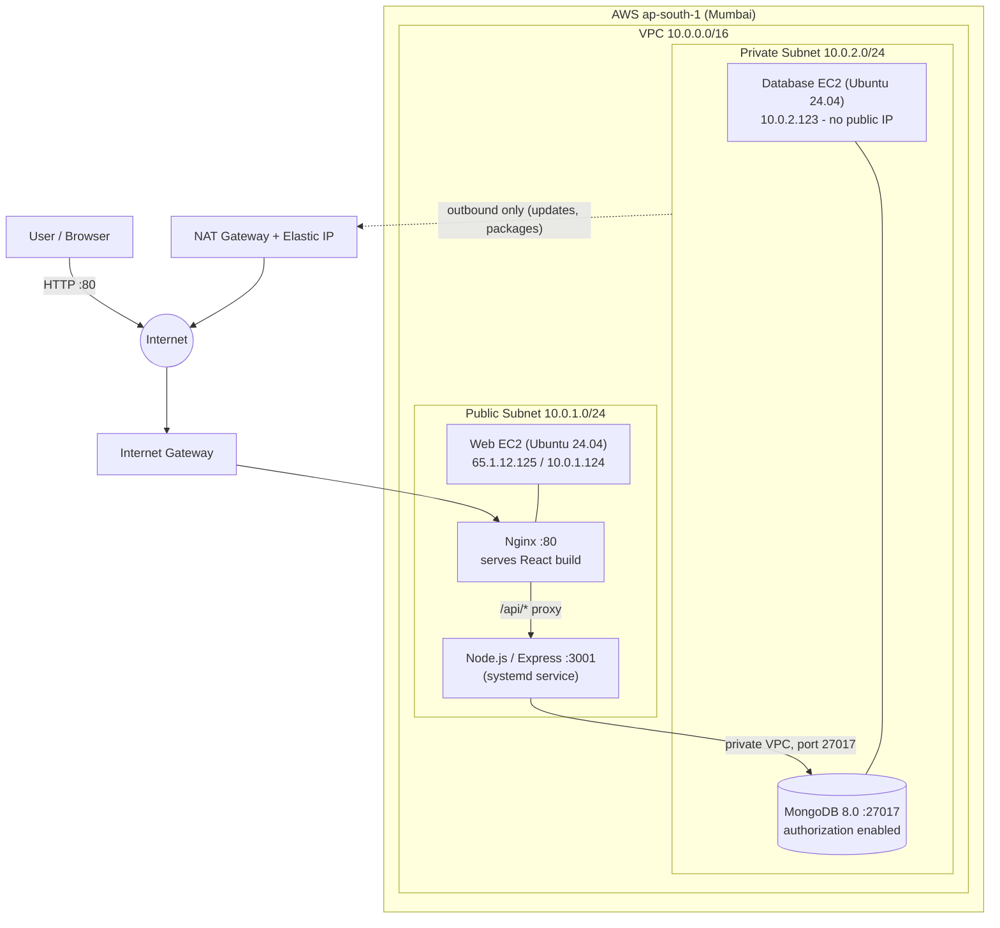
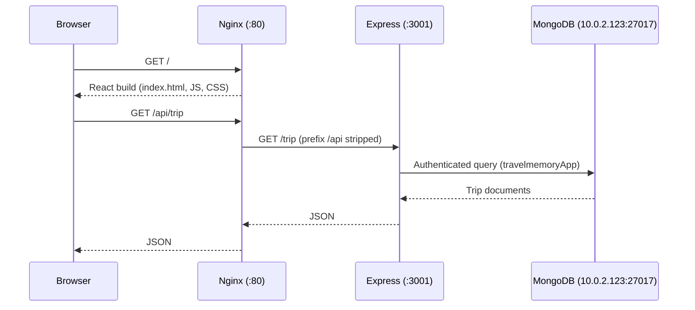

# TravelMemory – MERN Deployment on AWS with Terraform & Ansible

> Automated deployment of the **TravelMemory** MERN application on AWS using **Terraform** for infrastructure provisioning and **Ansible** for configuration management and application deployment.

| | |
|---|---|
| **Application** | [TravelMemory](https://github.com/UnpredictablePrashant/TravelMemory) |
| **Cloud / Region** | AWS – `ap-south-1` (Mumbai) |
| **IaC / Config Mgmt** | Terraform `>= 1.5` (AWS provider `~> 6.0`) · Ansible Core 2.21 |
| **OS** | Ubuntu 24.04 LTS |
| **Stack** | MongoDB 8.0 · Express.js · React · Node.js 22 |
| **Live URL** | http://65.1.12.125 |
| **Health check** | http://65.1.12.125/api/health |

---

## Table of Contents

1. [Project Overview](#1-project-overview)
2. [Architecture](#2-architecture)
3. [Repository Structure](#3-repository-structure)
4. [Prerequisites](#4-prerequisites)
5. [Part 1 – Infrastructure with Terraform](#5-part-1--infrastructure-with-terraform)
6. [Part 2 – Configuration & Deployment with Ansible](#6-part-2--configuration--deployment-with-ansible)
7. [How the Components Interact](#7-how-the-components-interact)
8. [Security Hardening](#8-security-hardening)
9. [Verification & Testing](#9-verification--testing)
10. [Screenshots / Demo Evidence](#10-screenshots--demo-evidence)
11. [Troubleshooting Notes](#11-troubleshooting-notes)
12. [Assignment Requirements Checklist](#12-assignment-requirements-checklist)
13. [Known Limitations & Future Improvements](#13-known-limitations--future-improvements)
14. [Cleanup & Cost Management](#14-cleanup--cost-management)
15. [Submission](#15-submission)

---

## 1. Project Overview

This project deploys the TravelMemory MERN application on AWS using a **two-server architecture**:

- **Public EC2 (web server)** – runs Nginx, the built React frontend, and the Node.js/Express backend.
- **Private EC2 (database server)** – runs MongoDB with authentication enabled; no public IP.
- **Nginx** serves the frontend and reverse-proxies `/api/` requests to the backend.
- The **backend** reaches MongoDB over the private VPC network.
- **Terraform** provisions and manages AWS resources; **Ansible** configures both servers and deploys the application.

---

## 2. Architecture



### Request flow



### Network summary

| Resource | Value |
|---|---|
| VPC (existing, reused) | `vpc-01c802cbcc72851e8` – `10.0.0.0/16` |
| Public subnet (existing) | `subnet-0a9e582f8a988b34a` – `10.0.1.0/24` – `ap-south-1c` |
| Private subnet (existing) | `subnet-036fa41084dc466f4` – `10.0.2.0/24` – `ap-south-1c` |
| Internet Gateway (existing) | `igw-026d4e2173e20d178` |
| NAT Gateway | Created by Terraform (public subnet, with Elastic IP) |
| Public route table | `0.0.0.0/0` → Internet Gateway |
| Private route table | `0.0.0.0/0` → NAT Gateway (existing VPC endpoint route retained) |

### Instances

| Property | Web Server | Database Server |
|---|---|---|
| Name | `travelmemory-web` | `travelmemory-database` |
| Instance ID | `i-08601baf2ac7bc6c5` | `i-0b05c98077d1efbfd` |
| Type | `t3.micro` | `t3.micro` |
| Subnet | Public | Private |
| Private IP | `10.0.1.124` | `10.0.2.123` |
| Public IP | `65.1.12.125` | None |
| Storage | 12 GB encrypted gp3 | 12 GB encrypted gp3 |

---

## 3. Repository Structure

```text
Assignment/
├── README.md
├── terraform/
│   ├── providers.tf        # AWS provider + Terraform version constraints
│   ├── variable.tf         # Input variables
│   ├── terraform.tfvars    # Variable values (SSH admin CIDR)
│   ├── data.tf             # Lookups for existing VPC, subnets, IGW, route tables
│   ├── nat.tf              # Elastic IP, NAT Gateway, private default route
│   ├── security_group.tf   # Web and database security groups
│   ├── iam.tf              # EC2 IAM role and instance profile
│   ├── ec2.tf              # Web and database EC2 instances
│   ├── outputs.tf          # Public IP, DNS, private IP, SG IDs
│   └── .gitignore
├── ansible/
│   ├── inventory.ini       # [web] and [database] hosts, SSH jump-host config
│   ├── site.yml            # Master playbook (imports mongodb.yml, web.yml)
│   ├── mongodb.yml         # MongoDB install, hardening, users
│   ├── web.yml             # Node.js, Nginx, backend, frontend deployment
│   ├── group_vars/
│   │   ├── database.yml    # Python interpreter for MongoDB automation
│   │   └── all/vault.yml   # Ansible Vault-encrypted DB credentials
│   ├── templates/          # Jinja2 templates (.env, Nginx site, systemd unit)
│   └── .gitignore
└── application/            # TravelMemory source code (backend + frontend)
```

---

## 4. Prerequisites

Developed on macOS (Apple Silicon). Tools used:

| Tool | Version | Purpose |
|---|---|---|
| Git | 2.54.0 | Version control |
| AWS CLI | 2.36.19 | AWS authentication |
| Terraform | 1.16.1 | Infrastructure provisioning |
| Ansible Core | 2.21.5 | Configuration & deployment |
| jq | 1.7.1 | JSON processing |
| MongoDB Compass | – | Database inspection |

Install the required Ansible collection:

```bash
ansible-galaxy collection install community.mongodb
```

Configure and verify AWS access:

```bash
aws configure                 # region: ap-south-1
aws sts get-caller-identity
```

An existing EC2 key pair (`shiwanshu-HV-keypair`) is used for SSH. Restrict the permissions of the private key:

```bash
chmod 400 /path/to/shiwanshu-HV-keypair.pem
```

> The private key stays on the local machine only. It is never copied to the servers or committed to Git.

---

## 5. Part 1 – Infrastructure with Terraform

### 5.1 Initialization and configuration

- **Provider:** AWS `~> 6.0`, region `ap-south-1`; Terraform `>= 1.5`.
- **Variables (`variable.tf`):** region, project name, VPC/subnet/route-table IDs, instance type, SSH admin CIDR, key pair name.
- **Data sources (`data.tf`):** look up the existing VPC, subnets, Internet Gateway and route tables so networking is reused rather than duplicated. The latest Ubuntu 24.04 AMD64 AMI is also resolved dynamically.

### 5.2 Networking

- Existing public and private subnets are reused.
- `nat.tf` creates an **Elastic IP**, a **NAT Gateway** in the public subnet, and a default route from the private route table through the NAT Gateway.
- The private instance gets outbound internet (packages, security updates) without ever having a public IP.

### 5.3 Security groups

**Web server**

| Port | Protocol | Source | Purpose |
|---|---|---|---|
| 22 | TCP | Administrator IP `/32` | SSH (admin only) |
| 80 | TCP | `0.0.0.0/0` | HTTP |
| 443 | TCP | `0.0.0.0/0` | HTTPS (reserved; TLS not yet configured) |

**Database server**

| Port | Protocol | Source | Purpose |
|---|---|---|---|
| 22 | TCP | Web server security group | SSH via jump host |
| 27017 | TCP | Web server security group | MongoDB |

Outbound traffic is allowed on both. MongoDB is never exposed to the public internet.

### 5.4 IAM

`iam.tf` creates the `travelmemory-ec2-role` role and `travelmemory-ec2-profile` instance profile, attached to both instances. No extra permissions are attached (least privilege), because the application does not call AWS APIs. Policies (e.g., SSM, CloudWatch) can be added later if needed.

### 5.5 EC2 instances

- Ubuntu 24.04 LTS, `t3.micro`, encrypted gp3 root volumes (12 GB)
- IMDSv2 required, EBS optimization and detailed monitoring enabled
- Web server in the public subnet with a public IP; database server in the private subnet with none

### 5.6 Outputs

`outputs.tf` exposes: web server public IP, public DNS, database private IP, and both security group IDs.

```text
web_public_ip = "65.1.12.125"
```

### 5.7 Running Terraform

```bash
cd terraform
terraform init
terraform fmt -recursive
terraform validate
terraform plan -out=travelmemory.tfplan
terraform apply travelmemory.tfplan
```

Result:

```text
Apply complete! Resources: 9 added, 0 changed, 0 destroyed.
```

---

## 6. Part 2 – Configuration & Deployment with Ansible

### 6.1 Connectivity

`inventory.ini` defines two groups, `[web]` and `[database]`, plus the SSH key, `ubuntu` user and Python interpreter settings. The private database host is reached through the web server via an **SSH ProxyCommand jump host**.

```bash
cd ansible
ansible -i inventory.ini all -m ping
```

Both hosts respond with `pong`.

### 6.2 Database server – `mongodb.yml`

| Step | Detail |
|---|---|
| Packages | `gnupg`, `curl`, `python3-venv`, `unattended-upgrades` |
| Auto security updates | `/etc/apt/apt.conf.d/20auto-upgrades` |
| MongoDB 8.0 | Official signing key + APT repo via `deb822_repository`; installed version `8.0.34` |
| Network binding | `127.0.0.1` and `10.0.2.123` only |
| Authentication | `security.authorization: enabled` in `/etc/mongod.conf` |
| Users | `travelmemoryAdmin` (`root`, auth DB `admin`) and `travelmemoryApp` (`readWrite` on `travelmemory`) |
| Automation env | Python venv at `/opt/mongodb-venv` with `pymongo>=4,<5` for `community.mongodb` modules |

**Kernel compatibility workaround:** on the AWS Ubuntu kernel, MongoDB initially failed to start because of a glibc restartable-sequences (rseq) incompatibility. Fixed with a systemd drop-in at `/etc/systemd/system/mongod.service.d/rseq.conf`:

```ini
[Service]
Environment=GLIBC_TUNABLES=glibc.pthread.rseq=1
```

### 6.3 Web server – `web.yml`

1. Install **Nginx**, `curl`, `ca-certificates`, `unattended-upgrades`.
2. Install **Node.js 22** (NodeSource) – `v22.23.4`, NPM `10.9.9`.
3. Deploy the TravelMemory source to `/opt/travelmemory/application`.
4. Install dependencies with `npm ci` in `backend/` and `frontend/`.
5. Build the React frontend with `REACT_APP_BACKEND_URL=/api npm run build` and publish to `/var/www/travelmemory`.
6. Create the persistent upload directory `/var/lib/travelmemory/uploads` (kept separate from source code).
7. Template the backend `.env` and the `travelmemory-backend` systemd unit.
8. Configure the Nginx site and reload.

### 6.4 Backend configuration

`/opt/travelmemory/application/backend/.env` (mode `0600`, owned by the `ubuntu` app user):

```env
MONGO_URI=mongodb://travelmemoryApp:<APP_PASSWORD>@10.0.2.123:27017/travelmemory?authSource=travelmemory
PORT=3001
CORS_ORIGIN=http://65.1.12.125
UPLOAD_DIR=/var/lib/travelmemory/uploads
MAX_UPLOAD_MB=5
TRUST_PROXY=1
```

`<APP_PASSWORD>` is injected from Ansible Vault at deploy time – it is never stored in plaintext in the repo.

**Systemd service** `travelmemory-backend`: runs Node.js as the `ubuntu` user, loads the `.env` file, restarts automatically on failure, starts on boot, and uses `NoNewPrivileges=true`.

### 6.5 Nginx reverse proxy

Config: `/etc/nginx/sites-available/travelmemory` (symlinked into `sites-enabled`; default site removed).

| Location | Behavior |
|---|---|
| `/` | Serves the React build from `/var/www/travelmemory`; `try_files $uri $uri/ /index.html` for SPA routing |
| `/api/` | Proxies to `http://127.0.0.1:3001/` with the `/api` prefix stripped (`/api/health` → `/health`) |
| `/uploads/` | Proxied to the backend upload endpoint |

Validated with `sudo nginx -t` before every reload.

### 6.6 Ansible Vault

Secrets live in `ansible/group_vars/all/vault.yml` (encrypted):

- `vault_mongodb_admin_password`
- `vault_mongodb_app_password`

Create your own with:

```bash
ansible-vault create ansible/group_vars/all/vault.yml
```

### 6.7 Full deployment

```bash
cd ansible
ansible-playbook -i inventory.ini site.yml --ask-vault-pass
```

`site.yml` imports `mongodb.yml` then `web.yml`. Latest run:

```text
Database server: ok=13 changed=0 unreachable=0 failed=0
Web server:      ok=22 changed=3 unreachable=0 failed=0
```

The second-run result (`changed=0` on the database host) demonstrates **idempotency**.

---

## 7. How the Components Interact

| Interaction | Mechanism |
|---|---|
| **Browser → Frontend** | HTTP on port 80 to the web server's public IP; Nginx serves the static React build |
| **Frontend → Backend** | React calls the relative path `/api`; Nginx proxies to Express on `127.0.0.1:3001` (same origin, so no cross-origin issues in practice; `CORS_ORIGIN` is also set) |
| **Backend → Database** | Mongoose connection to `10.0.2.123:27017` using the least-privilege `travelmemoryApp` user, allowed only by the database security group |
| **Admin → Web server** | SSH with key pair, restricted to the administrator's `/32` |
| **Admin → Database server** | SSH through the web server (jump host); no direct path from the internet |
| **Private subnet → Internet** | Outbound only, via NAT Gateway (updates and package installs) |
| **Terraform → Ansible** | Terraform outputs the web public IP and database private IP, which are used in `inventory.ini` |

---

## 8. Security Hardening

| Area | Implementation |
|---|---|
| Network isolation | Database in private subnet, no public IP |
| Firewalling (security groups) | SSH limited to admin `/32`; MongoDB and DB-SSH limited to the web security group |
| SSH | Key-pair authentication using the `ubuntu` user |
| Database auth | MongoDB authorization enabled; separate admin and app users; app user is `readWrite` on one database only |
| Secrets | Ansible Vault; `.env` mode `0600`; nothing sensitive committed |
| Instance metadata | IMDSv2 required |
| Encryption at rest | EBS volumes encrypted |
| Patching | `unattended-upgrades` on both servers |
| Process hardening | Backend runs as non-root user with `NoNewPrivileges=true` |
| Data separation | Uploads stored outside the source tree |
| IAM | Role/profile attached with no unnecessary permissions |

---

## 9. Verification & Testing

```bash
# Frontend
curl -I http://65.1.12.125
# -> HTTP/1.1 200 OK

# Backend + DB health
curl http://65.1.12.125/api/health
# -> {"status":"ok","db":"connected"}

# Trips API
curl -i http://65.1.12.125/api/trip
# -> HTTP 200 with saved trip data
```

- A test trip ("First Trip") was created through the API (HTTP `201`), retrieved with a GET request, and displayed in the browser UI after refresh – confirming the full frontend → backend → MongoDB path.
- **MongoDB Compass** was used to inspect the data through an SSH tunnel:

```bash
ssh -i /path/to/shiwanshu-HV-keypair.pem \
  -o IdentitiesOnly=yes \
  -N -L 27018:10.0.2.123:27017 ubuntu@65.1.12.125
```

Compass connection string: `mongodb://127.0.0.1:27018/travelmemory?directConnection=true` (user `travelmemoryApp`, auth database `travelmemory`).

---

## 10. Screenshots / Demo Evidence

All screenshots are stored in [`docs/screenshots/`](docs/screenshots/).

### 10.1 Project architecture


### 10.2 AWS infrastructure

**EC2 instances running**


**Security groups (web and database)**


### 10.3 MongoDB security and Ansible Vault

**MongoDB users created**


**MongoDB authorization enabled**


**MongoDB credentials managed through Ansible Vault**


**Vault-protected Ansible playbook run**


### 10.4 Application testing

**Test 1 - First Trip**


**Test 2 - First Trip**


**Test 3 - First Trip**


**Test 4 - First Trip**


**Test 5 - First Trip verified in MongoDB Compass**


### 10.5 Final health check

**Everything healthy and running fine**


**Demo video:** _add link here (optional)_

---

## 11. Troubleshooting Notes

| Problem | Cause | Resolution |
|---|---|---|
| `mongod` fails to start | glibc rseq incompatibility with the AWS Ubuntu kernel | systemd override setting `GLIBC_TUNABLES=glibc.pthread.rseq=1` |
| `community.mongodb` modules fail | Incompatible/missing PyMongo | Dedicated venv `/opt/mongodb-venv` with `pymongo>=4,<5` and `ansible_python_interpreter` set for the database group |
| Cannot reach private DB host | No public IP | SSH `ProxyCommand` through the web server |
| Duplicate default server warning in Nginx | Default site still enabled | Removed the default symlink from `sites-enabled` |

---

## 12. Assignment Requirements Checklist

### Part 1 – Terraform

| Requirement | Status |
|---|---|
| Configure AWS CLI and authenticate | ✅ |
| Initialize Terraform project for AWS | ✅ |
| VPC with one public and one private subnet | ✅ Existing VPC/subnets reused via data sources |
| Internet Gateway | ✅ Existing IGW reused |
| NAT Gateway | ✅ Created |
| Route tables for both subnets | ✅ |
| Web EC2 in public subnet, DB EC2 in private subnet | ✅ |
| SSH access (public instance only from admin IP) | ✅ |
| Security groups for web and database | ✅ |
| IAM role for EC2 | ✅ |
| Output public IP of web server | ✅ |

### Part 2 – Ansible

| Requirement | Status |
|---|---|
| Ansible configured to reach EC2 instances | ✅ |
| Install Node.js and NPM | ✅ |
| Application source deployed and dependencies installed | ✅ |
| Install and configure MongoDB | ✅ |
| Secure MongoDB, create users and databases | ✅ |
| Configure env variables and start the application | ✅ systemd service |
| React frontend communicates with Express backend | ✅ Nginx `/api` proxy |
| Security hardening | ✅ See [Section 8](#8-security-hardening) |

### Deliverables

| Deliverable | Status |
|---|---|
| Terraform scripts | ✅ `terraform/` |
| Ansible playbooks | ✅ `ansible/` |
| Detailed report | ✅ This README |
| Screenshots / video | ✅ Screenshots in [Section 10](#10-screenshots--demo-evidence) |
| GitHub push + VLearn submission | ⏳ See [Section 15](#15-submission) |

---

## 13. Known Limitations & Future Improvements

1. **HTTPS/TLS** – port 443 is open but no certificate is configured; the app is served over HTTP. Next step: domain name + Let's Encrypt (Certbot) with HTTP → HTTPS redirect.
2. **SSH hardening** – can be made explicit in Ansible: `PermitRootLogin no`, `PasswordAuthentication no`, plus `fail2ban`.
3. **Host firewall** – UFW can be added as defense-in-depth on top of security groups (allow 22/80/443 on web; 22/27017 from the web host only on DB).
4. **Application dependencies** – `npm audit` reported warnings; review and fix without blindly using `--force`.
5. **Remote Terraform state** – move state to S3 with DynamoDB locking for team use.
6. **Domain & DNS** – replace the raw public IP with a Route 53 record.
7. **Backups & monitoring** – scheduled `mongodump`/EBS snapshots and CloudWatch alarms.
8. **Cost** – NAT Gateway, Elastic IP, EC2 and EBS continue to incur charges while running.

---

## 14. Cleanup & Cost Management

> **Do not destroy the infrastructure until screenshots/video are collected and the submission is complete.**

```bash
cd terraform
terraform state list            # review managed resources
terraform plan -destroy         # preview what will be removed
terraform destroy               # confirm when prompted
```

This removes only resources in this Terraform state. The reused VPC, subnets, and Internet Gateway were not created by this project and are not managed by it.

---

## 15. Submission

**Before pushing to GitHub, make sure the following are excluded (via `.gitignore`):**

- AWS private key (`*.pem`)
- `*.tfstate`, `*.tfstate.*`, `.terraform/`, `*.tfplan`
- Any `*.tfvars` containing secrets
- Ansible Vault password files
- Plaintext credentials
- `ansible/group_vars/all/vault.yml` (unless your repository policy explicitly allows an encrypted vault)

**Steps:**

1. Push the repository to GitHub.
2. Copy the repository URL.
3. Paste the URL into a text, Word or PDF file.
4. Submit that file via **VLearn**.

**Repository URL:** _add link here_

---

## Conclusion

TravelMemory was deployed end-to-end on AWS with infrastructure fully defined in Terraform and server configuration automated in Ansible. The database runs privately with authentication, secrets are managed with Ansible Vault, and the application is verified working: frontend loads, the API health check reports `db: connected`, and records persist in MongoDB.

**Application:** http://65.1.12.125 · **Health:** http://65.1.12.125/api/health
